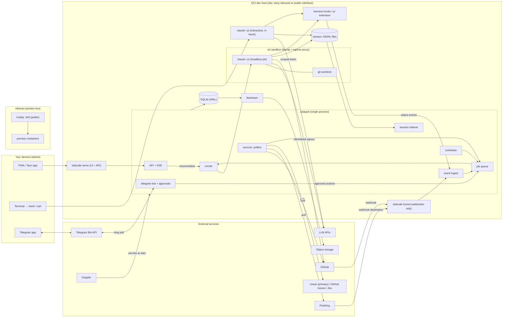

# Coding Factory — Guiding Document

The shared source of truth for three repos: **rock**, **catapult**, and **conveyer**. Each repo has its own plan that builds on this document:

| Repo | Local path | Plan |
|---|---|---|
| rock | `~/Code/personal/linux-hardening` (remote: `rock` on tangled) | `plans/rock.md` |
| catapult | `~/Code/personal/catapult` | `docs/plan.md` |
| conveyer | `~/Code/personal/conveyer` | `docs/plan.md` |

**This copy in rock (`plans/00-guide.md`) is canonical.** catapult and conveyer keep a copy at `docs/guide.md`. Edit this one, then run `bin/sync-guide` in rock to refresh the copies. If a repo plan contradicts this guide, the guide wins until it is updated.

Supersedes `agent-platform-plan*.md`. Carried over from those plans: harness JSONL is canonical, one process owns each session, profiles are fixed YAML, Herdr is a client and not the source of truth, and unattended work always runs in its own worktree.

---

## 1. What this is

A personal, single-user system on a remote dev box. It runs coding agents (Claude Code, pi) both interactively and as scheduled or event-driven jobs. You watch and steer them from a terminal, a PWA/desktop app, and Telegram.

**In scope**
- **rock:** hardened, rebuildable VPS provisioning, reachable only over Tailscale
- **catapult:** the orchestrator (scheduler, durable job queue, event ingest, runner, approvals), the workers (PR babysitter, PostHog alert triage, backlog grooming), and the UI for sessions and per-project schedules and jobs
- **conveyer:** personal agent configuration (instructions, skills, hooks), synced across laptop and VPS

**Out of scope (deliberately)**
- Selling it, multiple tenants, multiple users. It may be open-sourced later, so keep secrets and personal data out of code.
- The consumer app-builder product
- Agent memory (mem0 or similar). There is a slot for it in conveyer but no design yet.
- Any access to production data or deploys. The dev box is dev-only.
- A browser-based shell. Herdr over SSH covers that.

---

## 2. Hosts

| Host | Provider | Role | Runs |
|---|---|---|---|
| **OCI** | Oracle Ampere A1 (arm64, 4 vCPU, 24 GB free tier) | `dev`, **primary** | Interactive sessions, catapult, all workers |
| **Hetzner** | Cloud VM (amd64) | `preview` | Preview deployments of software built on OCI. No agents, no catapult. |

- Both hosts are provisioned by rock; the role picks the modules.
- The preview host is the only place that serves public HTTP(S) (Caddy on 80/443). The dev host serves nothing publicly except the optional Funnel webhook endpoint.
- Getting builds from OCI onto Hetzner is out of scope for now. It is a candidate for a later catapult worker, and it would need its own deploy-only credential.

---

## 3. Principles

1. **Deterministic shell, agentic core.** Code, cron and queues own control flow. An agent run is a function call with typed input, a budget and an expected artifact. Agents never decide what runs next across jobs.
2. **Verification over generation.** A job is done when it produces evidence (tests run, output attached, diff summarised), not when the agent says it is done. Review load is the bottleneck; don't add throughput that makes it worse.
3. **Humans gate main and prod.** Agents propose. Merges, and any externally visible action beyond "push to a branch or post a comment", need an approval that is recorded with who, when and what.
4. **Harness transcripts are canonical conversation state.** Claude Code and pi JSONL files hold the conversation. SQLite holds operational state only. Never copy transcripts into a second store.
5. **One driver per session.** At any moment exactly one process sends input to a session. Other clients read.
6. **Single writer.** Only the catapult orchestrator process writes its SQLite database. Hooks, workers and the UI talk to it over its API.
7. **Polling is the source of truth; webhooks only cut latency.** Everything must work correctly with webhooks disabled.
8. **Isolation by trust tier**, not for everything (see §6).
9. **Least privilege.** Scoped tokens, no production credentials, and the VPS cannot reach the laptop over the tailnet.
10. **Disposable box.** Everything on a host can be rebuilt from rock plus conveyer plus the Litestream backup plus the git remotes.
11. **Build what you'll use daily first.** Every phase ends with a manual acceptance test before the next one starts.

---

## 4. Repos and boundaries

| Repo | Owns | Does not own |
|---|---|---|
| **rock** | cloud-init, OS hardening, Tailscale and its ACL policy, runtimes and CLIs (git, gh, node, claude, pi, srt, bwrap, doppler, herdr), sandbox prerequisites, host roles (`dev`, `preview`) | Anything catapult-specific: units, DB, workers, Litestream |
| **catapult** | Orchestrator, queue, sources, runner, harness adapters, sandbox profiles, workers, Telegram bot, UI, its systemd unit, Litestream config and install | OS setup, personal agent preferences |
| **conveyer** | Global `AGENTS.md`, skills, Claude and pi settings, hook scripts, pi extensions, per-host overlays, a future memory slot | Job-specific worker prompts (those live in `catapult/workers`) |

**Contracts between repos**
- **rock → catapult:** on a `dev` host there is a non-root user `dev`; Node 24 LTS with pnpm through corepack; `bwrap` working for `dev` (AppArmor profile in place); `srt` on `PATH`; the Doppler CLI; `tailscale serve/funnel` available; and `/srv/catapult/{data,worktrees}` owned by `dev`.
- **conveyer → catapult:** hooks POST events to `CATAPULT_INGEST_URL` (unset means disabled; on the dev host it is `http://127.0.0.1:7700/ingest`) and **fail open**: if catapult is down, the hook exits 0 immediately.
- **catapult → conveyer:** none. catapult must work with a vanilla harness config, with hooks as a latency and status improvement only.

Rule of thumb for where code goes: if it would be useful on any fresh box, it belongs in rock. If it expresses how *you* like agents to behave, it belongs in conveyer. If it schedules, runs or records work, it belongs in catapult.

---

## 5. Architecture

Key properties:
- On the dev host, the only public listener is the Funnel webhook endpoint, and it is optional. Telegram uses long polling.
- Interactive and headless sessions look the same to the UI: both write JSONL and both fire hooks.
- An approved action becomes a job. There is no separate execution path.

---

## 6. Isolation tiers

A single mechanism, **`srt`** (Anthropic's sandbox-runtime: bubblewrap on Linux plus a domain-allowlisting egress proxy), is used for both harnesses. There is **no gVisor and no microVMs**: Hetzner cloud VMs don't expose KVM, and the Oracle Ampere box is not relied on for it.

| Tier | Used for | Isolation |
|---|---|---|
| `interactive` | You at the terminal | Claude Code's native sandbox (optional); pi unsandboxed or `srt` |
| `trusted` | Unattended job, input written by you (your tickets, your schedules) | Own worktree, `srt` with a broad allowlist |
| `untrusted` | Unattended job, input written by others (external PR comments, alert payloads, public issues) | Own worktree, `srt` with a narrow allowlist, no secrets in the environment beyond a per-job scoped token |
| `unsandboxed` | Per-project opt-in for jobs that need Docker (testcontainers and similar) | Own worktree only. Only allowed with `trusted` input. |

Rules:
- Never stack sandboxes. A job under `srt` runs Claude Code with its native sandbox disabled.
- Tier is decided by **the source of the input**, not by the worker type.
- Every sandboxed tier denies reads of `~/.ssh`, `~/.config/gh`, `~/.doppler`, `/srv/catapult/data`, and the Docker socket.

---

## 7. Core vocabulary and data model

| Term | Meaning |
|---|---|
| **project** | One repository plus its settings, including which tracker it uses |
| **tracker** | The backlog source for a project: `linear` (default), `github`, or `jira` |
| **schedule** | A cron rule that produces jobs for a project |
| **job** | A unit of work: worker type, typed input, tier, budget, idempotency key, state |
| **run** | One attempt at a job. Links to exactly one harness session. |
| **session** | A Claude Code or pi conversation, identified by harness plus session id. May have no run (interactive). |
| **action** | A side effect an agent proposes that needs approval (merge, close issue, update ticket, open PR from a report) |
| **approval** | A decision on an action: who, when, what, and via which channel |
| **driver** | The single process allowed to send input to a session right now |

Job states: `queued → leased → running → (succeeded | failed | cancelled | needs_input)`, with retries going back to `queued` and a backoff.

Every job has: `max_turns`, `max_wall_seconds`, an optional `max_cost_usd`, and `max_rounds` (for looping workers, default 5 per project).

---

## 8. Security baseline

- SSH is reachable only over Tailscale. It is enforced by ufw (allow on `tailscale0` only) and by the provider firewall (OCI security list / Hetzner firewall) as a second layer.
- Tailscale ACLs: `you → tag:rock-dev, tag:rock-preview` allowed; `tag:rock-dev → tag:rock-preview:22,443` allowed (for previews); nothing else is reachable from either tag. Neither host can reach your laptop or phone.
- The dev user cannot reach the cloud metadata service (169.254.169.254), so an agent can't read user-data or instance credentials.
- GitHub access through a GitHub App (or fine-grained PAT) limited to catapult's repos. Contents, PR and issues write; no admin; branch protection on `main`.
- **Secrets live in Doppler.** Hosts get a Doppler service token after provisioning (never in cloud-init user-data), and processes read secrets with `doppler run`. Untrusted-tier jobs get only a short-lived scoped token.
- The webhook endpoint verifies signatures (GitHub HMAC, PostHog shared secret) and rate-limits.
- The Telegram bot accepts updates only from allowlisted user ids.
- No production credentials exist on the dev host.

---

## 9. Tech defaults

Defaults, not dogma. Change them with a note in §11.

- **Language:** TypeScript everywhere in catapult and conveyer's pi extension.
- **Runtime:** Node 24 LTS, running `.ts` directly through Node's built-in type stripping. No build step for the server. pnpm workspaces.
- **DB:** `node:sqlite` (built in, no native module to compile on arm64), WAL mode, plain SQL migrations.
- **HTTP:** Hono on `@hono/node-server`.
- **Tests:** Vitest.
- **UI:** Vite + React PWA. Tauri wrapper later.
- **Harness drivers:** the harness CLIs over JSON stdio (`claude -p --input-format stream-json --output-format stream-json`, `pi --mode rpc`) run inside `srt`, not in-process SDKs. The sandbox wraps the real process, both harnesses look the same, and there are fewer dependencies.
- **Provisioning:** cloud-init plus idempotent bash (shellcheck-clean).
- **Target OS:** Ubuntu 24.04 LTS, arm64 (OCI) and amd64 (Hetzner).

---

## 10. Cross-repo roadmap

| Phase | rock | conveyer | catapult | Acceptance |
|---|---|---|---|---|
| 0 | cloud-init baseline, Tailscale-only access, sandbox prerequisites, roles | Minimal global `AGENTS.md`, install script | Spike: harness resume, hooks, srt+pi on arm64 | Fresh OCI VM to working `claude` and `pi` in herdr in under 15 min; a spike report is written |
| 1 | Tailscale ACL policy as code | Hooks that POST to ingest | Core: DB, queue, runner, session index, CLI | `catapult run` launches a sandboxed job; `claude --resume` of the job's session works |
| 2 | — | — | PR babysitter + Telegram notifications | A real PR's review comments are addressed within the round limit, with no loops |
| 3 | — | — | Approvals + PostHog triage | A PostHog error produces a Telegram report; approving it opens a draft PR; the approval is recorded |
| 4 | — | Shared skills | Groomer (Linear first, then GitHub and Jira) | Backlog items are refined and applied only after approval |
| 5 | — | — | UI: read-only threads + projects/schedules | You can see every session (interactive and headless) and every job from your phone |
| 6 | — | Memory slot (mem0) | UI: steer/approve/cancel, Tauri app | Steer a UI-started session, then take it over in the CLI |

---

## 11. Decision log

| # | Decision | Why |
|---|---|---|
| D1 | Consumer product is out of scope | A different company and market; must not shape this architecture |
| D2 | Single user, may be open-sourced | Removes tenancy and billing complexity; keep code free of personal data |
| D3 | SQLite, not Postgres | Small scale, single writer, easy backup with Litestream |
| D4 | bubblewrap via `srt` for all isolation; no gVisor or microVMs | No KVM on target hosts; consistent with Claude Code; the threat is injection, not kernel exploits |
| D5 | Tailscale, not raw WireGuard | ACLs, SSH, mobile apps and Funnel/Serve for free |
| D6 | cloud-init, no custom images | Provider-agnostic, versioned, re-runnable |
| D7 | Telegram first for approvals and notifications | Solo use; no workspace setup; long polling needs no inbound port |
| D8 | PostHog for observability input | The user's stack |
| D9 | Babysitter `max_rounds` per project, default 5 | Prevents bot-to-bot review loops |
| D10 | Observability output is triage + summary + proposed fix; code changes only after approval | Most alerts are noise; keeps review load down |
| D11 | Harness JSONL is canonical; SQLite is operational only | Avoids two diverging sources of truth |
| D12 | Memory deferred | Build it once real retrieval gaps are known |
| D13 | Linear is the primary tracker; GitHub Issues and Jira secondary; chosen per project | The user's workflow; one `Tracker` interface keeps workers tracker-agnostic |
| D14 | Doppler for secrets; never in user-data | User-data is readable through the metadata service |
| D15 | OCI is the primary dev host; Hetzner is preview-only | Free arm64 capacity for agents; previews need public HTTPS, which the dev host must not have |
| D16 | Repo names: rock (provisioning), catapult (orchestrator), conveyer (agent config) | — |
| D17 | SSH restricted by firewall, not by `ListenAddress` | Ubuntu 24.04 socket-activates sshd, and binding to the Tailscale IP races tailscaled at boot |
| D18 | Harness CLIs over JSON stdio, not SDKs | srt wraps the real process; one driver shape for both harnesses |

## 12. Open questions

- How do builds get from OCI to the Hetzner preview host (push over the tailnet, or a registry)? Decide when previews become a catapult worker.
- Should interactive pi sessions on the dev host also run under `srt` by default?
